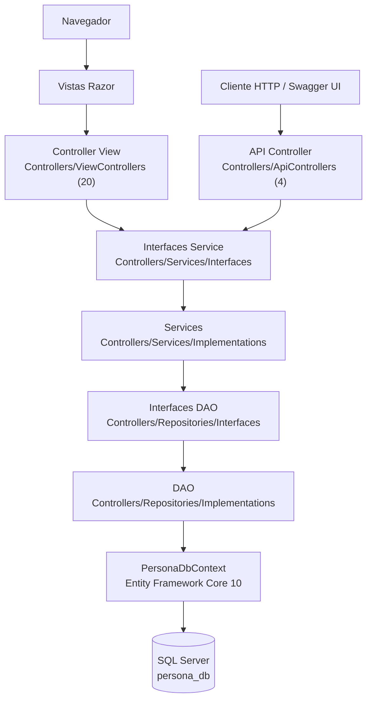
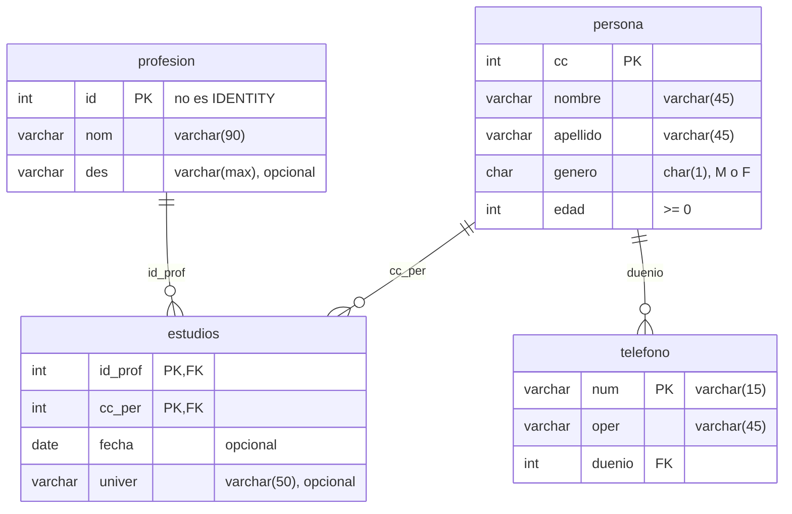
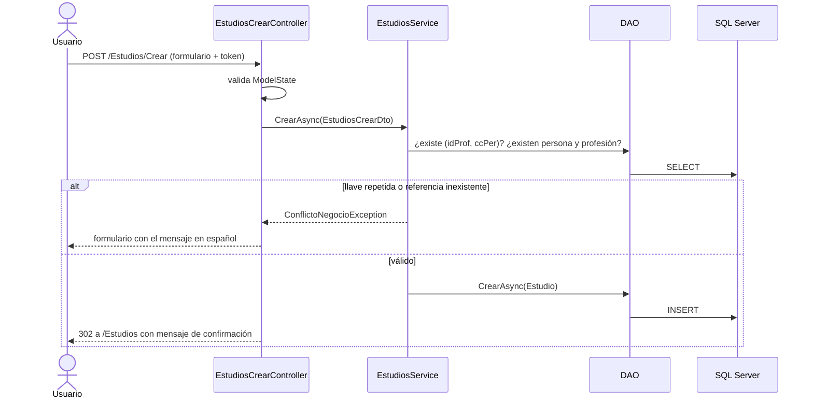

# Diagramas

GitHub muestra los diagramas Mermaid directamente.

## Capas del monolito

Las vistas y la API comparten los mismos Services. Ningún controlador accede a los DAO ni al `DbContext`.

## Modelo de datos

Las llaves foráneas no borran en cascada (`NO ACTION`). Una persona con estudios o teléfonos, o una profesión con
estudios, no se puede eliminar.

## Flujo de una petición: crear un estudio desde la vista

